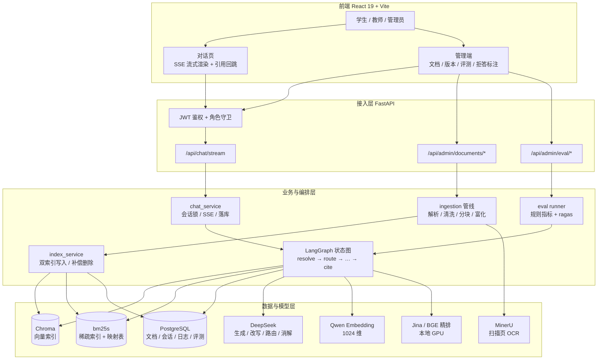
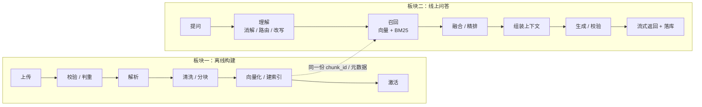
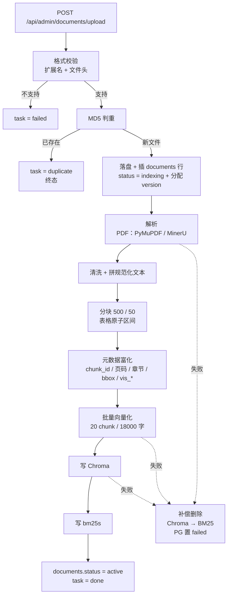
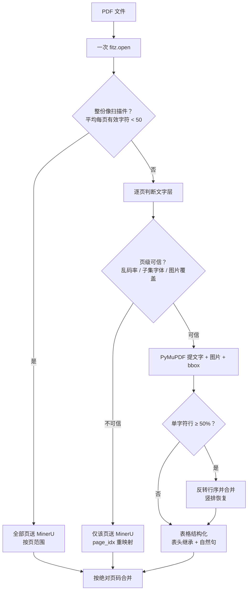
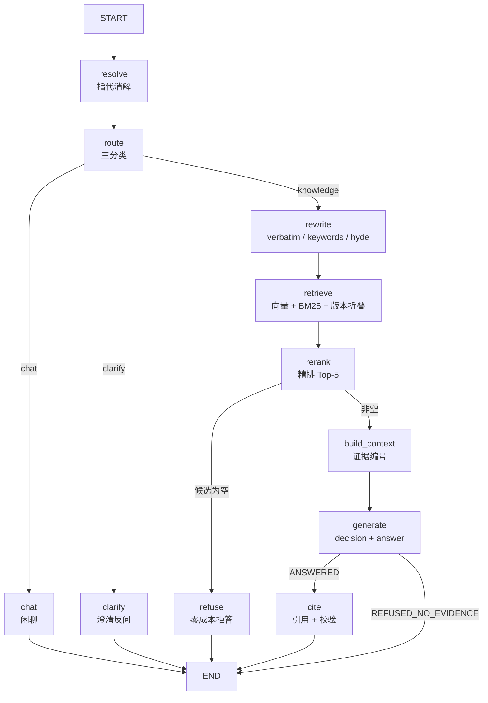

# 校园 RAG 系统学习文档

> **用途**：面试前快速建立“全局地图 → 两条主流程 → 每个节点怎么讲”的完整认知。
> **读法建议**：
> 1. 第一遍只看 **第一章 + 每节末尾的「口播」**，先能做到 2 分钟讲清整个项目；
> 2. 第二遍按板块看 **流程图 + “为什么这么设计”**，把节点之间的关系串起来；
> 3. 面试前 10 分钟只看 **每节的「面试官可能问」+ 口播 + 附录 D 速记卡**。
>
> **代码口径**：以当前 `refactor/campus-rag` 分支为准；配置数字来自 `backend/app/config/app.yaml`，代码位置都标了文件与行号。
> **配套材料**：`docs/导学-校园RAG.md`（学习路径）、`docs/面经-校园RAG.md`（题库式面经）、`docs/校园RAG系统重构方案.md`（设计决策原始记录）。

---

## 目录

- [第一章 全局视角：先把项目讲成一个故事](#ch1)
- [第二章 板块一：离线构建流程（文档入库）](#ch2)
- [第三章 板块二：线上检索问答流程](#ch3)
- [第四章 横切设计：面试官最爱追问的四个“全局问题”](#ch4)
- [附录](#appendix)
  - [附录 A｜高频追问速查（20 问一句话）](#appendix-a)
  - [附录 B｜源码地图（按学习顺序）](#appendix-b)
  - [附录 C｜三天学习路线](#appendix-c)
  - [附录 D｜面试前 10 分钟速记卡](#appendix-d)

> 正文里的内容小标题已统一为三级标题并带 `x.x.x` 编号（如 `2.4.1 解析链路`、`3.8.3 降级链`），在 VS Code / Typora / Obsidian 的大纲面板中可以直接跳转；附录 C 使用 `C.1`–`C.4` 编号。

<a id="ch1"></a>

# 第一章 全局视角：先把项目讲成一个故事

## 1.1 一句话定位

**这是一个面向校园规章制度的 RAG 问答系统：学生用口语提问，系统从 PDF / Word / PPT 等公文里检索依据，流式生成“每句话都有出处”的答案，并能一键跳回原文。**

它解决的不是“能不能答”，而是三个更工程化的问题：

| 问题 | 本项目的回答 |
|---|---|
| 公文里的精确文号、专有名词，向量检索抓不住 | 向量 + BM25 双路召回，RRF 融合，交叉编码器精排 |
| 大模型会编造制度条款 | 只依据证据回答；句级引用；服务端校验；证据不足就拒答 |
| 制度有新旧版本、有角色权限 | 检索期版本折叠；一套 ACL 同时管检索和原文下载 |

**面试时的定位**：这不是一个“调 API 的 Demo”，而是一条**可评测、可降级、可追溯**的 RAG 工程链路。

---

## 1.2 系统分层：四层结构



**四层各自的一句话：**

- **前端**：对话页负责流式渲染和引用回跳；管理端负责文档、版本、评测、拒答标注。
- **接入层**：只做参数校验和响应封装，业务都在 service 层；身份只从 JWT 来。
- **业务与编排层**：`chat_service` 管会话锁、SSE、落库；LangGraph 管 11 个节点的条件和分支；`ingestion` 管离线建库。
- **数据与模型层**：PostgreSQL 是元数据与历史权威；Chroma 和 bm25s 是两个检索索引；DeepSeek 负责生成与查询理解；嵌入和精排各自独立。

> **面试官常追问的点**：为什么不用 LangChain 的 Chain/Agent？
> 答：编排用 LangGraph，但模型调用是自写 httpx 客户端，检索、融合、精排、流式 JSON 解析都是自己实现的。原因是这条链路需要细粒度的降级、观测和流式控制，通用 Chain 抽象反而会把这些藏起来。

---

## 1.3 两条主流程总览（大颗粒度）



**构建流程（离线）一句话：**
把一份非结构化公文，变成**可检索、可引用、可权限控制**的 chunk：上传 → 校验 → 解析 → 清洗 → 分块 → 富化 → 向量化 → 双索引写入 → 激活。

**线上流程一句话：**
把一句口语问题，变成**有依据、有引用、可追溯**的答案：消解 → 路由 → 改写 → 召回 → 融合 → 精排 → 组装 → 生成 → 引用校验 → 流式返回。

**两条流程的连接点**是 `chunk_id` 和元数据：构建期写入 `document_id:chunk_index` 的稳定 ID，线上期用它做 RRF 去重、引用映射、日志和评测。

---

## 1.4 技术选型：为什么是这些

| 层 | 选型 | 为什么选它 | 面试可讲的一句话 |
|---|---|---|---|
| 编排 | **LangGraph `StateGraph`**（无 checkpointer） | 需要条件边、流式事件、节点级追踪；历史权威在 PostgreSQL，不需要图检查点 | “图是无状态的，每轮从 messages 表重建状态，检查点反而会制造第二份历史。” |
| 生成模型 | **DeepSeek `deepseek-flash`，非思考模式** | 便宜、快、支持 JSON 与流式；关思考是必须项，思考模式下 `content` 可能为空 | “关思考不是优化，是节点 9 的 JSON 解析器只认 content，思考模式会把预算烧在 reasoning 上。” |
| 嵌入 | **通义 `qwen3.7-text-embedding`，1024 维** | 中文语义、API 稳定、维度与 Chroma collection 一致 | “换嵌入模型必须全量重建索引，维度一致也不能混用，因为新旧向量不在同一坐标系。” |
| 向量库 | **Chroma（嵌入式 PersistentClient）** | 本地部署、metadata 过滤、零运维 | “代价是必须单进程，多 worker 会抢同一个 sqlite 文件。” |
| 稀疏检索 | **bm25s + jieba** | 精确文号、专有名词；磁盘持久化；中文分词 | “旧项目用 `str.split()`，中文等于没分词；bm25s 还要求映射表和分词结果同代。” |
| 精排 | **Jina Reranker v3.5（listwise）/ BGE v2-m3（pointwise）** | 交叉编码器排序质量高；两套后端可切换 | “精排是唯一依赖 GPU 的环节，也是唯一的硬件单点，所以降级链必须完整。” |
| 关系库 | **PostgreSQL + asyncpg，无 ORM** | 文档元数据、会话、日志、评测；事务和唯一约束 | “SQL 手写是为了看清锁和索引，不用 ORM 是为了不被隐式查询坑。” |
| 服务 | **FastAPI + SSE** | 异步流式、类型校验、OpenAPI | “SSE 用 fetch + ReadableStream，不用 EventSource，因为后者不能带 JWT。” |
| 前端 | **React 19 + Vite + zustand + shadcn + pdf.js** | 流式增量渲染、引用回跳、管理端 | “引用回跳优先用 bbox 坐标高亮，没有 bbox 才退到文本匹配。” |
| 观测 | **Langfuse** | 追踪、token 成本、指标回查、告警 | “节点 metadata 只放耗时、召回数、降级类型，不放正文。” |
| 评测 | **自建规则指标 + ragas（隔离虚拟环境）** | ragas 与主环境依赖冲突，装进去会段错误 | “ragas 跑在 `.venv-ragas` 子进程里，主环境一个包都不动。” |
| OCR | **MinerU（按页限定范围）** | 只把不可信页送出去，成本低 | “整份 PDF 送 OCR 是 50 倍浪费，我们按页重映射。” |

### 1.4.1 选型里最值得讲的三组取舍

1. **Chroma 嵌入式 vs 外部向量库**：换来零运维和简单，代价是强制单进程，不能横向扩展。
2. **交叉编码器 vs 只用向量相似度**：换来排序质量，代价是 GPU 显存和冷启动；所以有预热、信号量、降级。
3. **ragas 隔离环境 vs 装进主环境**：换来主环境稳定，代价是多一套环境和子进程通信；实测装进去会让 `sentence_transformers` 段错误，直接抽掉精排地基。

---

## 1.5 项目级高频面试题 + 口播

> 这一节的题是“整项目视角”，后面每个节点还有更细的追问。

### 1.5.1 Q1. 请用一分钟介绍一下这个项目

**答题骨架**：做什么 → 关键技术 → 亮点 → 结果。

> **口播**：
> “这是一个面向校园规章制度的 RAG 问答系统。学生用口语提问，系统从 PDF、Word、PPT 等公文里检索依据，流式生成带引用的答案。后端是 FastAPI 加 LangGraph，检索是向量加 BM25 双路召回、RRF 融合、交叉编码器精排，生成用 DeepSeek。答案里的每个结论句都要挂引用标记，前端可以一键跳回原文。项目还做了权限隔离、版本治理、降级和评测。”

### 1.5.2 Q2. 为什么用 RAG，不直接微调，或者把全文塞给大模型？

**答题骨架**：知识更新 → 可追溯 → 成本与注意力。

> **口播**：
> “校园制度会更新，微调把知识写进参数里，改一条政策就要重训，而且没法给出处。RAG 把知识和模型分开：文档更新只重建索引，答案还能追溯到具体文件和页码。长上下文也不能替代检索，因为制度文档多、窗口再大也有成本，而且把所有文档塞进去会稀释注意力。这个场景答案必须可追溯，所以 RAG 更合适。”

### 1.5.3 Q3. 一次提问从输入到答案，完整链路是什么？

> **口播**：
> “线上从提问开始，先做指代消解，把‘那这个呢’补全成自包含问题；再路由成闲聊、澄清或知识库问答；知识库这条会生成原句、关键词、假设答案三类查询，分别打向量和 BM25 两路召回；然后按版本和权限过滤，用 RRF 融合，交叉编码器精排到 Top-5；组装上下文时编号，模型输出 decision 和 answer；最后解析正文里的引用标记，产出引用和校验报告，流式返回并落库。”

### 1.5.4 Q4. 为什么要做混合检索？只用向量检索不行吗？

> **口播**：
> “向量检索擅长语义相近，但对‘桂电教〔2025〕28号’这种精确串不敏感，文号里的数字和符号在嵌入空间几乎没有区分度；BM25 正好相反，对专有名词和文号很准，但不懂同义改写。所以两路都跑，用 RRF 按排名融合，而不是分数相加，因为两种分数量纲不同。融合后再用交叉编码器精排，保证最终排序质量。”

### 1.5.5 Q5. 你怎么保证模型不瞎编？

> **口播**：
> “四层：第一，提示词硬约束只依据证据回答，证据不足必须拒答；第二，答案必须带句级引用标记，没标记的结论句会被校验出来；第三，引用编号由服务端从正文派生，不让模型单独输出，越界用证据条数做上界；第四，流式已经发出去的内容撤不回，所以定位是标注而不是拦截，前端把未证实的句子置灰，指标进仪表盘。规则校验只做字面和数字比对，不做语义蕴含，这是明确的边界。”

### 1.5.6 Q6. 多轮对话里的“那这个呢”怎么处理？

> **口播**：
> “每轮从 messages 表重新加载历史，图是无状态的，不用 LangGraph 的 checkpointer。历史先过一个低成本闸门：没有历史、没有代词、也没有省略特征就跳过消解；有‘它’‘那个’‘那 2025 级的呢’这种才调模型补全。路由上只有上一轮是 knowledge 才允许粘住，chat 和 clarify 不粘，避免答非所问和反复反问。历史超预算会做滚动压缩，摘要和未压缩消息一起算 token；压缩失败就退回未压缩历史，不让用户看到 500。”

### 1.5.7 Q7. 文档更新、旧版本怎么处理？

> **口播**：
> “版本按标题分组，版本号在事务内分配，取组内所有行的最大 version 加一，失败行也占号。检索期做版本折叠：回查 PostgreSQL 取 active 且已生效的最大版本，只返回这一版，所以停用新版时上一版会自动恢复。文档改了权限或生效日期，必须重写 Chroma 的 metadata，因为过滤读的是向量库那份；写入顺序按收紧或放宽方向决定，保证失败时停在更保守的一侧。”

### 1.5.8 Q8. 权限怎么隔离？管理员提权怎么防止成为后门？

> **口播**：
> “权限只有一个判定源 `filters.py`，向量检索、BM25 的文档过滤、原文下载三处共用。公式是状态 active、已生效、并且公开或当前角色可见。不可见一律返回 404 不是 403，让‘不可见’和‘不存在’不可区分，防止探测文档是否存在。管理员提权只对 admin 生效，拿到的 chunk 会标 escalated，评测里能直接统计越权引用。”

### 1.5.9 Q9. 检索、精排、生成某一环挂了怎么办？

> **口播**：
> “外部依赖很多，所以每个环节都有明确降级：单路检索失败用另一路继续，记降级事件；精排失败跳过精排、按 RRF 顺序返回，置信度置空；查询改写失败退化成原句；消解超时透传原问题；生成上游格式错误只发 error，不伪装成拒答；压缩失败退回未压缩历史。降级不是只打日志，统一词表落库，指标里能统计降级率。原则是宁可降级，不让请求 500。”

### 1.5.10 Q10. 你怎么证明你的优化有效？

> **口播**：
> “检索用确定性指标 Recall@5 和 MRR，还有分路对照，避免‘两路看着都在跑、实际只有一路有效’。多轮用真实图跑题库，看路由准确率、澄清误报、消解锚点命中；消解还要做对照，只差消解一个变量。生成用 ragas 四项，装在隔离环境，避免和主环境依赖冲突。消融是累积开关，最后一行重复上一行配置测噪声底。指标都带语料规模，小语料会饱和，不能外推。”

### 1.5.11 Q11. 这个项目最难的地方是什么？

> **口播**：
> “最难的是那些‘不报错但静默变差’的问题。比如 Chroma 的日期比较只认数字，传字符串会让向量路全部降级，混合检索等于从来没生效过，表面看只是召回少一点；还有 BM25 的 collection.get 不保证按传入 id 顺序返回，排序被整条丢掉，表现为 BM25 好像没起作用。我们的应对是把降级留痕、做单路对照和消融，让这类问题能被指标发现。”

### 1.5.12 Q12. 如果让你重做，你会改什么？

> **口播**：
> “如果重做，我会更早把评测和可观测搭起来，而不是先堆功能；还会把向量库和 BM25 换成可共享的外部服务，解除单进程限制，才能横向扩展。另外限流、上传体积上限、语义蕴含校验这些目前是明确的待办，不是已经做完的。”

---

## 1.6 开场自我介绍模板

### 1.6.1 30 秒版

> “我做过一个校园规章制度 RAG 问答系统。它的核心不是把文档丢给大模型，而是把检索、引用、权限和评测做成一条可上线的链路：双路召回加精排保证召回质量，句级引用和服务端校验控制幻觉，版本折叠和 ACL 保证答案现行且不越权。整个后端是 FastAPI + LangGraph，前端 React 流式渲染，评测用自建指标加 ragas。”

### 1.6.2 2 分钟版

> 在 30 秒版基础上，再补三段：
> 1. **构建侧**：PDF 文字层质检、扫描页按页 OCR、表格原子切分、三存储顺序写入和失败补偿；
> 2. **线上侧**：指代消解、三分类路由、三查询扩展、RRF 融合、精排降级、流式 JSON 解析；
> 3. **质量侧**：Recall@5 / MRR、消解对照、ragas 隔离环境、降级事件和 trace 回查。

---

<a id="ch2"></a>

# 第二章 板块一：离线构建流程（文档入库）

## 2.0 板块全景：一份文件如何变成可检索的知识



**这条板块的主线只有一句话：**
**先把“文档行”建出来，再把内容变成 chunk，最后把状态翻成 active。** 中间任何一步失败，都走补偿删除，但 PostgreSQL 的行永远保留。

### 2.0.1 三个贯穿全板块的设计原则

| 原则 | 具体做法 | 为什么 |
|---|---|---|
| 先建行，后建索引 | 先插 `documents` 行（`status=indexing`），再写 Chroma / BM25，最后翻 `active` | 检索条件要求 `active`，半成品天然不会被搜到 |
| 失败补偿，不是事务回滚 | 删 Chroma → 删 BM25 → PG 只置 `failed` | 三个异构存储做不到原子提交；失败行承载“传过但失败了”的事实 |
| 元数据只存一份权威，其余冗余 | PostgreSQL 是权威；Chroma 冗余过滤字段；BM25 映射表存 chunk_id | 检索要快，不能每次 join；但冗余必须可重建 |

---

## 2.1 节点 1｜上传入口与任务登记

**一句话**：接收文件，先落临时盘，再建任务行，最后把摄入丢到后台跑。

**输入 → 输出**：`UploadFile + 表单` → `task_id / batch_id`，后台任务开始执行。

**关键代码（`backend/app/api/documents.py:37-54`）：**

```python
task_id, batch_id = await docs.create_upload(
    filename=filename, content=await file.read(),
    uploader_id=user.id, trace_id=trace_id,
    title=title, visibility=visibility,
    visible_roles=visible_roles, effective_date=effective_date,
)
req = docs.build_request(...)
docs.schedule_ingest(req, trace_id=trace_id, span_id=span_id)
return {"batch_id": batch_id, "tasks": [{"task_id": task_id, ...}]}
```

**为什么这么设计：**

- **先落临时盘**：上传接口不能一边收流一边解析，先落盘才能算 MD5、做格式嗅探、失败重试。
- **文件名必须净化**（`document_service.py:61-63`）：`Path("data/tmp") / "../../evil.txt"` 会跳出目录，而写临时文件发生在入库之前，等于“上传即可往任意路径写文件”。
- **后台任务显式挂 trace**：`asyncio.create_task` 不会继承 `contextvars`，所以 `trace_id` 落库、进任务时再挂回来（`document_service.py:151-167`）。
- **单文件和 zip 批量统一结构**：单文件时 `batch_id = task_id`，前端不用写两套；当前实现只做单文件，批量字段是预留。

**面试官可能问：**

- 为什么上传接口不直接同步解析？
- 后台任务怎么保证日志能串起来？
- 文件名净化为什么不能只挡第一段 `../`？

> **口播**：
> “上传接口只做参数校验和响应封装，业务在 service 层。文件先落到 data/tmp，文件名必须净化，防止 `../` 跳出目录；然后写 ingestion_tasks 行，再把任务丢到后台。后台任务不能依赖 contextvars 隐式继承，所以 trace_id 显式落库、进任务时再挂回来。单文件和 zip 批量用同一套 batch_id/task_id 结构，单文件时 batch_id 等于 task_id，前端不用写两套。”

---

## 2.2 节点 2｜格式校验与 MD5 判重

**一句话**：先确认“这真的是支持的文件”，再确认“这份文件以前没传过”。

**输入 → 输出**：临时文件 → `(是否支持, 提示语)`；MD5 → 已存在的文档行或 `None`。

**关键代码（`backend/app/ingestion/file_type.py:43-64`）：**

```python
if head[:4] == PDF_MAGIC:
    return "pdf"
if head[:4] == ZIP_MAGIC:
    window = head[:_HEAD_SCAN]
    if _CONTENT_TYPES.encode() not in window:
        return None          # 普通 zip，不是 OOXML
    if _WORD_MARKER in window:
        return "docx"
    if _PPT_MARKER in window:
        return "pptx"
```

**为什么这么设计：**

- **扩展名 + 文件头双校验**：用户会把 zip 改名成 `.docx`；只判 `PK` 又分不出普通 zip 和 docx，必须再看 `[Content_Types].xml` 和 `word/` / `ppt/`。
- **提示语说人话**：PNG、JPEG、旧版 `.doc`、普通 zip 各有专门提示，用户知道该转什么格式。
- **MD5 判重只认成功过的行**（`versioning.py:65-76`）：`active / disabled / indexing` 才算“已存在”；`failed` 不阻止重传，因为那正是用户想重试的场景。
- **`duplicate` 是终态**：不会被进度流拖住，前端可以立刻结束。

**面试官可能问：**

- 为什么不能只看扩展名？
- 为什么 MD5 相同就直接跳过，不做 chunk 级 diff？
- 失败过的文件再传，会被判重挡住吗？

> **口播**：
> “只看扩展名不够，用户会把 zip 改名成 docx。我们用扩展名加文件头双重校验：PDF 看 `%PDF`，docx/pptx 看 PK 头，再进 zip 里确认 `[Content_Types].xml` 和 `word/` 或 `ppt/` 目录。只判 PK 分不出普通 zip 和 docx，这是旧项目踩过的坑。txt/md 没有可信签名，只能试编码。这层是给人看的早拦，不是安全边界，真正的把关是解析器本身。”

---

## 2.3 节点 3｜落盘、建行与版本号分配

**一句话**：把文件存到正式目录，在 PostgreSQL 里建一行“建索引中”的记录，并在事务内分配版本号。

**输入 → 输出**：临时文件 + 标题 → `document_id / doc_group_id / version`。

**关键代码（`backend/app/ingestion/versioning.py:48-62`）：**

```python
row = await conn.fetchrow(
    "SELECT doc_group_id, MAX(version) AS max_version "
    "  FROM documents WHERE title = $1 "
    " GROUP BY doc_group_id ORDER BY max_version DESC LIMIT 1", title)
if row is None:
    return uuid.uuid4().hex, 1
# MAX(version) 覆盖该组全部行：failed 行也占着版本号，不能跳过
return row["doc_group_id"], int(row["max_version"]) + 1
```

**为什么这么设计：**

- **按标题精确匹配文档组**：同名文档视为同一制度的不同版本，沿用同一个 `doc_group_id`。
- **版本号必须在事务内分配**：两个管理员同时上传同一组，若各自读到相同的“旧版 version”，会撞 `UNIQUE(doc_group_id, version)`。
- **`MAX(version)` 包含 `failed` / `indexing` 行**：失败行永不删除，它占着版本号；只按 `active` 取最大值，下次上传会分到已被占用的号，而且这种错“平时不出现，出过一次失败上传之后才开始出现”，最难排查。
- **先建行**：行是失败补偿的锚点，没有 `document_id` 就无法按文档清理索引。

**面试官可能问：**

- 版本号为什么不能在应用层算？
- 为什么失败行不删除？
- 并发上传同一份文档会怎样？

> **口播**：
> “新文档按标题精确匹配已有文档组，版本号取该组所有行的最大 version 加一，包括 failed 和 indexing 的行，不只是 active。因为失败行永不删除，它占着版本号；只按 active 取最大值，下次上传会撞 UNIQUE(doc_group_id, version)，而且是出过一次失败上传之后才开始出现，最难排查。版本分配必须在 PostgreSQL 事务内，配合唯一约束兜底并发上传。”

---

## 2.4 节点 4｜内容解析：PDF 两路分支（重点）

**一句话**：把文件变成“按页的文本 + 图片 + bbox + 章节标记”；PDF 只把**文字层不可信**的页送 OCR。

### 2.4.1 解析链路



### 2.4.2 关键设计 1：判据是“文字可不可信”，不是“有没有图”

`backend/app/ingestion/loaders/pdf.py:290-326` 的页级判据只有两条：

- 乱码率 ≥ 30% → 该页走 OCR；
- 图片覆盖率 ≥ 80% → 该页判扫描页。

**没有设字符数下限**：真正无文字层的扫描页会因为 `text` 为空被拦下；而“文末版记页只有 30 多字”是清晰可读的，不该白烧 OCR。

> 这是项目里一个很典型的坑：把**整份级**的“平均每页有效字符 < 50”错当成**页级**阈值，结果 5 份公文各多送了一页给 MinerU，内容没错、成本白花，而且很难发现。

### 2.4.3 关键设计 2：一次遍历同时做三件事

`load_pdf` 只 `fitz.open` 一次，同时完成：

- 文字提取；
- 图片提取（引用面板缩略图）；
- 页面类型判定（是否走 OCR）。

旧链路同一个 PDF 被打开 3–4 次，每次重建 xref 和页树。

### 2.4.4 关键设计 3：竖排检测必须在清洗之前

`pdf.py:105-106`：

```python
lines = [ln.strip() for ln in text.split("\n")]
return "".join(ln for ln in reversed(lines) if ln)
```

**动作是“反转行序并合并”，不是“反转全部字符”，也不是丢弃。** 清洗会先删掉“成文日期”这种单字符行；如果先清洗再反转，日期就永远救不回来了。

### 2.4.5 关键设计 4：表格按原子区间处理，不做跨页合并

- PDF 表格先被 `find_tables()` 抽出来，再序列化成**自然句**，例如：
  `课程内容是无偿献血，参考学分是2分/次。`
- 表头可以继承：上一页的表伸到页面下部、本表从页顶开始、列数兼容，才判续页。
- **不做跨页合并**：RAGFlow 曾有事故，只凭“下一页顶部 y 位移为负”就合并两张独立表，结果静默丢表。本项目只做表头继承，失败就降级为“无表头”，不破坏数据。
- 空白申请表会被识别并剔除，避免把模板噪声写进索引。

**关键代码（`backend/app/ingestion/loaders/pdf.py:517-536`）：**

```python
if (not whole_scanned) and _page_is_usable(page, text):
    if single_char_line_ratio(text) >= float(
            cfg("ingestion.vertical_text_single_char_ratio", 0.5)):
        text = reverse_line_order(text)
    text, boxes, prev_table = _text_with_tables(
        block_texts, boxes, page, prev_table=prev_table, page_text=text)
    result.pages.append(PageText(
        page=page_no, text=text,
        bbox=[{"page": page_no, **b} for b in boxes],
        image_paths=_extract_images(doc, page, page_no, image_dir)))
else:
    needs_ocr.append(page_no)
```

### 2.4.6 其他格式的解析方式

| 格式 | 解析方式 | `page` 语义 |
|---|---|---|
| DOCX | `python-docx`，结构化标题 | 恒为 1（分页是渲染产物） |
| PPTX | `python-pptx`，按幻灯片 | 幻灯片序号，从 1 起 |
| MD | 结构化标题 | 恒为 1 |
| TXT | 编码回退链 UTF-8 / GBK / GB18030 | 恒为 1 |

**面试官可能问：**

- PDF 为什么分两路？怎么判断一页要不要 OCR？
- 竖排检测为什么必须在清洗之前？
- 表格为什么不做跨页合并？
- MinerU 返回的 `page_idx` 为什么要重映射？

> **口播**：
> “PDF 的判据不是‘有没有图’，而是‘文字层可不可信’。我们先一次 fitz.open 同时做文字提取、图片提取和类型判定：整份平均每页有效字符太少就判扫描件，全部页送 MinerU；否则逐页看乱码率、子集字体和图片覆盖率，只把不合格的那一页按页范围送 OCR，不整份送。竖排检测必须在清洗之前，因为清洗会先删掉成文日期那种单字符行，反转就救不回来了；动作是反转行序并合并，不是丢弃。”

---

## 2.5 节点 5｜清洗与规范化文本

**一句话**：删掉页眉页脚、页码、目录行和控制字符，拼出一份**全链路共用的规范化文本**。

**输入 → 输出**：`[(页码, 页文本)]` → `normalized_text + page_slices`。

### 2.5.1 清洗规则（`backend/app/ingestion/clean.py`）

| 规则 | 例子 | 注意 |
|---|---|---|
| 控制字符 | `Cc / Cf / Cs` 类 | 保留 `\n` `\t` |
| 跨页重复短行 | 页眉、页脚、红头 | 至少出现 60% 的页、长度 ≤ 40 才删 |
| 独立数字行 | 页码 `- 3 -` | `^\d{1,4}$` |
| 目录行 | `第一章 ...... 3` | 连续点号 + 页码 |
| 表格组标记 | `【表头】` | **永不删**，删了表格改造就静默作废 |

**关键代码（`backend/app/ingestion/clean.py:101-128`）：**

```python
for page_no, raw in page_texts:
    cleaned = clean_page(raw, repeated=repeated)
    if not cleaned:
        continue
    if parts:
        parts.append("\n\n")   # 页间分隔
        cursor += 2
    start = cursor
    parts.append(cleaned)
    cursor += len(cleaned)
    slices.append(PageSlice(page=page_no, char_start=start, char_end=cursor))
```

### 2.5.2 为什么规范化文本重要

- chunk 的 `char_start / char_end` 相对它，不是原始 PDF 的字节偏移；
- 引用回跳、bbox 归属、`page` 反查都以它为参照系；
- 页间记录 `page_slices`，字符偏移才能反查页码。

**面试官可能问：**

- 清洗会误删正文吗？怎么控制？
- 为什么不能直接用原始 PDF 的偏移？
- 页眉页脚是怎么识别的？

> **口播**：
> “清洗删控制字符、跨页重复的页眉页脚、页码行和目录行，但不碰表格组标记。产出的 normalized_text 是整条链路的坐标原点：chunk 的 char_start/char_end、引用回跳、bbox 全都相对它，不是原始 PDF 的字节偏移。页间还会记录 page_slices，让字符偏移能反查页码。这一步做错，后面引用定位会系统性错位。”

---

## 2.6 节点 6｜分块：500 字与表格原子性（重点）

**一句话**：把长文本切成 500 字左右、50 字重叠的片段；表格组不切、不跨页、不和正文合块。

**输入 → 输出**：`normalized_text` → `list[ChunkSpan]`，每个 span 带 `chunk_index / char_start / char_end / text`。

**关键代码（`backend/app/ingestion/chunker.py:142-158`）：**

```python
limit = min(pos + chunk_size, hard_limit)
floor = min(pos + max(min_size, chunk_size // 4), limit)
end = _best_break(text, pos, limit, floor=floor)
_emit(pos, end)

if end >= hard_limit:
    pos = end
    continue

next_pos = end - overlap
if next_pos <= pos:
    next_pos = end
pos = next_pos
```

### 2.6.1 三个关键点

1. **优先在中文句末标点断**（`。！？；\n`），找不到再退到次级标点（`，、：`），都不行才硬切。
2. **50 字重叠**：避免一个结论正好被切在边界上，两边都缺半句。
3. **表格是原子区间**：`chunk_text(atomic=...)` 命中区间就整段吐出，不切、不重叠；正文也不会吃进表格。

### 2.6.2 为什么表格必须原子

实测《第二课堂成绩单制度实施办法》的评分表：表头只在 chunk 12，数据行散布在 chunk 13–24，**79 条有效数据行里 28 条（35%）的“行标签”和“学分值”被切到不同 chunk**。如果切表，检索只命中一半，答案就会缺条件。

### 2.6.3 `chunk_id` 的生成规则（`chunker.py:35-37`）

```python
def make_chunk_id(document_id: str, chunk_index: int) -> str:
    return f"{document_id}:{chunk_index}"
```

它必须稳定且全局唯一，因为四处在用：引用、RRF 去重、`qa_logs`、评测集。

**面试官可能问：**

- 分块大小怎么定的？太小或太大分别有什么问题？
- 重叠有什么用？会不会造成重复召回？
- 为什么表格要单独处理？
- `chunk_id` 为什么不用随机 UUID？

> **口播**：
> “分块 500 字、50 重叠，优先在中文句末标点切，找不到再退次级标点，最小 5 字。重叠是为了避免一个结论正好被切在边界上，两边都缺半句。表格是原子区间：组内不切、也不和正文合块，因为切表会让行标签和学分值分到不同 chunk，检索只命中一半。表格还做了表头继承和自然句序列化，但不做跨页合并——跨页合并一旦误判就会静默丢表，我们宁可降级。”

---

## 2.7 节点 7｜元数据富化

**一句话**：给每个 chunk 补齐检索和引用需要的全部字段。

**输入 → 输出**：`DocumentMeta + ChunkSpan + 页切片 + 章节标记` → Chroma metadata。

### 2.7.1 字段与消费者（每个都不是“先存着”）

| 字段 | 谁在用 |
|---|---|
| `document_id / doc_group_id / version` | 版本折叠、引用、日志 |
| `status / effective_date / visibility / vis_*` | 检索期过滤公式 |
| `chunk_id` | RRF 去重、引用、qa_logs、评测集 |
| `char_start / char_end` | 引用回跳、文本高亮 |
| `page / bbox` | 引用回跳到页码和坐标框 |
| `current_chapter / chapter_level` | 引用溯源到章节 |
| `image_paths` | 引用面板缩略图 |

### 2.7.2 两个容易讲错的细节

- **日期存整数 `YYYYMMDD`**：Chroma 的 `$lte / $gte` 只接受 int / float，传 ISO 字符串会直接抛错，而且只在运行时暴露（`filters.py:65-81`）。
- **角色权限展开成三个布尔字段**：Chroma 的 `where` 只能在标量上做 `$eq`，对 JSON 字符串做不了成员判断；所以 `visible_roles` 进 Chroma 时展开成 `vis_admin / vis_staff / vis_student`。

### 2.7.3 章节归属（`backend/app/ingestion/enrich.py:53-71`）

旧实现把“全文档第一个标题”复制到每个 chunk，一份制度的所有片段都显示成“第一章”；PDF 更彻底，加载器从不写这个字段，实测 1244/1244 全为空。现在用 `chapter_at(marks, offset)` 取该偏移之前最近的章节标记。

**面试官可能问：**

- 为什么这些字段要冗余到向量库？
- 为什么不存 `visible_roles` 数组？
- 日期为什么不能用字符串？

> **口播**：
> “Chroma 不能 join PostgreSQL，过滤只能用自身 metadata，所以过滤字段必须冗余一份：status、effective_date、visibility、vis_*。chunk_id 是融合去重、引用、qa_logs、评测集四处在用的稳定键；char_start/end、page、bbox、chapter 是引用回跳的定位依据。有两个容易错的点：日期必须存整数 YYYYMMDD，因为 Chroma 的 `$lte` 不认字符串；角色权限展开成三个布尔字段，因为 Chroma 对 JSON 字符串做不了成员判断。”

---

## 2.8 节点 8｜向量化与双索引写入（重点）

**一句话**：先把 chunk 批量嵌入，再写 Chroma，最后写 BM25S。

**输入 → 输出**：`list[IndexEntry]` → 写入条数。

**关键代码（`backend/app/services/index_service.py:43-56`）：**

```python
vectors = await embed_texts(texts)
...
vector.upsert(
    ids=[e.chunk_id for e in entries],
    embeddings=vectors,
    documents=texts,
    metadatas=[e.metadata for e in entries],
)
bm25.add([(e.chunk_id, e.text) for e in entries])
```

### 2.8.1 向量化（`backend/app/retrieval/embedding.py`）

- 每批 **20 个 chunk / 18000 字**；
- 失败指数退避重试 3 次；
- 按服务端返回的 `index` 排序，避免乱序；
- 换任何嵌入模型都必须**全量重建索引**：维度一致 ≠ 可以混用，新旧向量不在同一个语义坐标系。

### 2.8.2 BM25S（`backend/app/retrieval/bm25.py`）

- 用 `jieba.lcut` 分词，旧项目的 `str.split()` 对中文完全失效；
- BM25S 没有 metadata，所以旁边持久化一份 **“下标 → chunk_id”映射表**，并且分词结果必须和映射表**同文件落盘**；
- 索引、映射表、`num_docs` 三者只要有一个不对，就判整路不可用——**不做部分恢复**，因为错位会返回别人的 chunk，比降级更糟。

**面试官可能问：**

- 为什么嵌入要分批？失败怎么办？
- BM25 为什么需要映射表？为什么不存 document_id？
- 换嵌入模型要注意什么？

> **口播**：
> “我们先把 chunk 批量向量化，每批 20 个、18000 字，失败指数退避重试。然后先写 Chroma，再写 BM25。BM25 没有 metadata，旁边必须持久化一份下标到 chunk_id 的映射表，还要和分词结果同代；索引、映射表、num_docs 三者只要有一个不对，就判整路不可用，不做部分恢复，因为错位会返回别人的 chunk，比降级更糟。换嵌入模型必须全量重建索引，维度一致也不能混用，新旧向量不在同一个语义坐标系。”

---

## 2.9 节点 9｜激活与失败补偿（重点）

**一句话**：全部索引写完后，最后把 `documents.status` 翻成 `active`；任何一步失败，走补偿删除。

**关键代码（`backend/app/ingestion/pipeline.py:279-288`）：**

```python
async with db.tx() as conn:
    await conn.execute(
        "UPDATE documents SET status = 'active', chunk_count = $2, "
        "normalized_text_path = $3, updated_at = now() WHERE id = $1",
        doc_id, written_chunks, str(normalized_path),
    )
```

### 2.9.1 失败补偿（`pipeline.py:301-322`）

```python
try:
    index_service.remove_from_index(doc_id)
except Exception:
    logger.exception("补偿删除索引时再次失败（可能留下半删状态）")
...
UPDATE documents SET status = 'failed' WHERE id = $1
```

### 2.9.2 删除顺序（`index_service.py:60-84`）

- 先删 Chroma，再删 BM25；
- BM25 的 chunk_id **向 BM25 索引自己查**，不能从 Chroma 反推——Chroma 已空时会推出空列表，留下“还搜得到”的孤儿；
- PostgreSQL 的行只置 `failed`，**永远不删**。

### 2.9.3 为什么“最后翻 active”能解决半成品问题

检索过滤公式第一项就是 `status = active`。所以：

| 阶段 | 状态 | 能否被检索到 |
|---|---|---|
| 已建行、未写完 | `indexing` | 否 |
| 写完 Chroma、未写 BM25 | `indexing` | 否 |
| 全部写完 | `active` | 是 |
| 中途失败 | `failed` | 否，但管理端可见、可重试 |

**面试官可能问：**

- 为什么不能先写索引再建行？
- 失败后为什么删除顺序要和写入相反？
- 为什么失败行不删除？

> **口播**：
> “任何解析或嵌入失败都走补偿删除：先删 Chroma，再删 BM25，删除顺序和写入完全相反。BM25 的 chunk_id 要向索引自己查，不能从 Chroma 反推，因为 Chroma 可能已经空了，会留下搜得到的孤儿。PostgreSQL 的行只置 failed、永远保留，因为它承载‘传过但失败了’这个事实；删了就分不清‘没传过’和‘传失败’，管理端也没法重试和排查。”

---

## 2.10 节点 10｜版本治理与文档变更（重点）

**一句话**：版本折叠在**检索期**做，不在入库时给旧版打“已废止”标；改权限/生效日期/状态要重写 Chroma metadata。

### 2.10.1 版本折叠

**检索期**回查 PostgreSQL（`backend/app/retrieval/search.py:112-122`）：

```sql
SELECT doc_group_id, MAX(version) AS latest
  FROM documents
 WHERE doc_group_id = ANY($1::text[])
   AND status = 'active'
   AND effective_date <= $2
 GROUP BY doc_group_id
```

只返回“现行版”的 chunk。**为什么不能直接在召回集里取最大值**：如果现行版 v5 的措辞和 query 不相似、已废止的 v4 相似，Top-N 里只有 v4；在召回集内折叠会把 v4 当成现行版返回，用户拿到已废止的政策。

**停用新版会怎样**：上一版自动“复活”，因为折叠基准是数据库里 active 且已生效的最大版本，不需要手工 enable。

### 2.10.2 改字段的重写顺序

`document_service.py:456-475` 区分“收紧”和“放宽”：

| 方向 | 先写哪边 | 为什么 |
|---|---|---|
| 收紧（公开→受限、启用→停用、角色变少、生效日推后） | 先 Chroma，后 PG | 最坏停在“检索已经变严、PG 还没更新” |
| 放宽（受限→公开、停用→启用、角色变多、生效日提前） | 先 PG，后 Chroma | 最坏停在“PG 已放宽、检索还严”，不会泄露 |

### 2.10.3 删除顺序（`document_service.py:520-557`）

先把行落到 `disabled` 中间态 → 删索引（Chroma → BM25）→ 删 PG 行。源文件和规范化文本保留，因为删了既不能回滚，也再拿不到原文。

**面试官可能问：**

- 版本折叠为什么不在入库时做？
- 停用当前版本后，学生搜到的是哪一版？
- 改权限为什么需要重写向量库？先写哪边？

> **口播**：
> “版本折叠放在检索期，不在入库时给旧版打废止标。每次检索回查 PostgreSQL，取组内 active 且已生效的最大 version，只返回这一版。这样停用新版时上一版会自动恢复，不需要手工 enable。改 visibility、effective_date、status 这些字段必须重写 Chroma 的 metadata，因为过滤读的是向量库那份冗余；而且写入顺序要看方向：收紧时先写 Chroma 再写 PG，放宽时反过来，保证失败时停在更保守的一侧。”

---

## 2.11 构建流程串讲（面试用）

**2 分钟口播：**

> “离线构建的目标是把一份公文变成可检索、可引用、可权限控制的 chunk。上传后先做扩展名加文件头的格式校验，再算 MD5 判重；新文件落盘，并在 PostgreSQL 里先建一行 status=indexing 的记录，在事务内分配版本号。解析阶段 PDF 分两路：文字层可信的页用 PyMuPDF，一次提取文字、图片和 bbox；不可信的页按页范围送 MinerU，不整份送。之后清洗出规范化文本，按 500 字、50 重叠分块，表格是原子区间不切。元数据补齐 chunk_id、页码、章节、bbox 和权限字段。然后批量向量化，先写 Chroma、再写 BM25，最后把状态翻成 active。任何一步失败都补偿删除索引，但 PostgreSQL 的失败行保留，方便排查和重试。”

---

<a id="ch3"></a>

# 第三章 板块二：线上检索问答流程

## 3.0 板块全景：一次提问如何变成有依据的回答



### 3.0.1 三个必须先记住的全局设定

1. **图是无状态的**：每轮 `new_state()` 新建，跨轮只保留 `session_id`、从 `messages` 加载的 `history`、`last_route`。**不用 LangGraph 的 checkpointer**——`messages` 表是历史的唯一权威。
2. **两条拒答路径**：候选为空 → `refuse` 节点（零成本、不调模型）；模型判定证据不足 → `generate` 返回 `REFUSED_NO_EVIDENCE` 直接到 END。
3. **只有 knowledge 路径才发引用**：`chat` 和 `clarify` 不检索、不引用、不发 `citations / verify`。

### 3.0.2 节点输入输出总表

| 节点 | 输入 | 输出 | 失败/降级 |
|---|---|---|---|
| resolve | query、history | `resolved_query`、`resolve_skipped_reason` | 超时透传原句，记 `timeout` |
| route | resolved_query、last_route、澄清计数 | `route`、`route_source` | LLM 失败兜底 `knowledge` |
| rewrite | resolved_query | `retrieval_queries`（最多 3 条） | 解析失败退化为 1 条 verbatim |
| retrieve | queries、user、include_restricted | `candidates` | 单路失败用另一路；两路都失败走拒答 |
| rerank | candidates、resolved_query | `reranked`、`retrieval_confidence` | 任何异常按 RRF 顺序返回，置信度 `None` |
| build_context | reranked | `context`、`evidence` | 无失败分支，预算内整块裁剪 |
| generate | context、evidence、history、summary | `decision`、`answer` | 上游格式错误只发 `error`，不伪装拒答 |
| cite | answer、evidence | `citations`、`verify_report` | 只标注，不阻断 |
| refuse | 候选为空 | 固定拒答文案 | 零成本短路 |

---

## 3.1 节点 0｜请求入口、会话锁与上下文加载

**一句话**：先抢会话长锁，再加载历史（必要时滚动压缩），最后用这份历史新建一个状态，进图执行。

**输入 → 输出**：`query + session_id + JWT` → `RAGState`。

### 3.1.1 会话长锁

`backend/app/services/chat_service.py:177-181`：

```python
if not await db.acquire_long_lock(session_id, holder):
    yield sse("error", {"code": "session_busy",
                        "message": "本会话正在生成中，请等待完成或新开会话"})
    return
```

**为什么需要长锁**：同一会话两个请求并发生成，会往 `messages` 写两条助手回复，历史就脏了。

**为什么是表而不是进程内锁**：服务是多请求并发的，进程内锁跨不了进程；而且锁要有 TTL，防止进程崩溃后永久占着。`session_locks` 表用 `ON CONFLICT ... WHERE expires_at < now()` 原子完成“空闲则拿、过期则抢”。

### 3.1.2 两个细节

- **心跳 30 秒续期，TTL 120 秒**：生成可能超过 2 分钟，没有心跳会被别人抢走。
- **释放必须带 holder**：`DELETE ... WHERE holder = $2`，否则一个已超时、锁被抢走的旧请求，结束时会把新持有者的锁删掉。

### 3.1.3 上下文加载与滚动压缩

**完整历史 = `compressed_summary` + `messages[compressed_count:]`。**

`backend/app/services/context_service.py:88-108` 的水位线：

| 参数 | 值 | 含义 |
|---|---|---|
| `history_token_budget` | 16000 | 历史预算 |
| `high_water_ratio` | 0.8 | 超过 12800 触发压缩 |
| `low_water_ratio` | 0.5 | 压到 8000 停 |
| `recent_messages_limit` | 10 | 最近 10 条原文永不动 |
| `compression_min_messages` | 6 | 单次至少压 6 条，避免每轮都调模型 |
| `summary_max_tokens` | 800 | 摘要自身上限，防止越压越胖 |

### 3.1.4 压缩算法（`context_service.py:193-200`）

```python
target = max(0, _low_water() - _summary_cap())
remaining = sum(costs)
merged = 0
while merged < compressible and (merged < _min_merge() or remaining > target):
    remaining -= costs[merged]
    merged += 1
```

### 3.1.5 三个关键约束

- **摘要计入预算**：否则摘要越长、可压原文越少，触发线却不动，压缩永远不收敛。
- **压缩失败不能拦住回答**：超时/报错就退回未压缩历史，记 `degradation_events(node="compaction")`。
- **空摘要绝不能回写**：写进去等于这批消息永久消失，用户会觉得助手突然失忆。

**面试官可能问：**

- 为什么不用 LangGraph 的 checkpointer？
- 会话锁为什么要有 TTL 和心跳？
- 压缩为什么要有高低水位，而不是一超就压？
- 压缩失败会让这一轮请求失败吗？

> **口播**：
> “每轮请求先抢会话长锁，抢不到直接返回 session_busy，不排队。锁有 120 秒 TTL、30 秒心跳，释放时必须校验 holder，避免旧请求把新持有者的锁删掉。然后从 messages 表加载历史，完整历史等于摘要加未压缩消息；超过 12800 token 就同步压缩，压到 8000 以下停，最近 10 条原文不动。压缩失败只记降级、退回未压缩历史，绝不让用户看到 500。图本身是无状态的，每轮新建状态，不用 checkpointer，因为 messages 表已经是唯一权威。”

---

## 3.2 节点 1｜resolve 指代消解（重点）

**一句话**：把“那这个要多久”补全成“转专业办理流程要多久”这样的自包含问题；没必要时一次模型调用都不花。

**输入 → 输出**：`query + history` → `resolved_query + resolve_skipped_reason`。

### 3.2.1 什么时候才调模型

`backend/app/graph/nodes/resolve.py:144-154`：

```python
if is_meaningless(query):
    return False, "gate"
history = state.get("history") or []
if not history:
    return False, "no_history"
if not (has_pronoun(query) or has_ellipsis_feature(query)):
    return False, "no_feature"
return True, "none"
```

### 3.2.2 三个判据

| 判据 | 说明 |
|---|---|
| 无信息量闸门 | 整条消息只有“你好/谢谢/？？？”，没有实际诉求 |
| 有历史 | 第一轮没有可消解的上下文 |
| 有代词 **或** 省略特征 | 两者满足一个才调模型 |

**代词必须 jieba 分词后按词匹配**，不能子串匹配，否则“其他”会误命中“他”（`resolve.py:137-141`）。

### 3.2.3 省略特征三条（`resolve.py:118-132`）

```python
if has_question and not has_policy_noun:
    return True          # 「那要提前几天申请？」
if text.endswith("呢"):
    return True          # 「那 2025 级的呢？」
if len(text) < 8 and not has_policy_noun:
    return True          # 「多久？」
```

> 中文多轮里省略比指代更常见，而且省略句往往没有代词；只判代词会漏掉这三种。

### 3.2.4 模型调用与失败处理

- 只给最近 8 条历史，要求输出 `{"resolved": "..."}`；
- 输出长度做上限校验，异常就透传原句；
- 超时记 `timeout`，其他异常记 `model_load_failed`；
- **跳过原因必须分类记录**：`gate / no_history / no_feature / timeout / none`。不能只用一个布尔，否则“主动跳过”和“失败跳过”会混在一起，污染评测对照。

**面试官可能问：**

- 为什么不每轮都做消解？
- 消解失败会不会让请求失败？
- 为什么跳过原因要分这么细？
- `resolve_unresolved` 为什么现在不参与路由？

> **口播**：
> “多轮里学生经常说‘那这个要多久’，原句直接检索基本命中不了。我们的做法是先做一层低成本闸门：没有历史、没有代词、也没有省略特征，就直接跳过，不花模型调用；只有像‘它’‘那 2025 级的呢’‘多久’这种才调一次模型补全。模型超时或输出异常就原样透传，绝不因为消解失败把请求打挂，同时把跳过原因分类记下来，避免超时样本污染评测。”

---

## 3.3 节点 2｜route 三分类与澄清闸门（重点）

**一句话**：把问题分成 `chat / clarify / knowledge`；规则层只做减法，拿不准交给 LLM，LLM 失败兜底 knowledge。

**输入 → 输出**：`resolved_query + last_route + 澄清计数` → `route + route_source`。

### 3.3.1 规则层的两条收严原则

`backend/app/graph/nodes/route.py:59-87`：

```python
pattern = cfg("rules.doc_number_pattern", "")
if pattern and re.search(pattern, text):
    return "knowledge"
if any(n in text for n in _policy_nouns()) and \
   any(q in text for q in _question_words()):
    return "knowledge"
if any(n in text for n in _policy_nouns()):
    return "knowledge"
if is_meaningless(text):
    return "chat"
return None
```

1. **规则层不判 `clarify`**：clarify 的语义就是“意图模糊”，而规则恰恰判断不了模糊。规则只负责明确的两类。
2. **规则层只做减法**：只有“确定是闲聊”才拦，**不做“短 → 闲聊”的推断**。早期设计有“短句判定”，会把“挂科了怎么办”“怎么申请”判成闲聊；而 chat 分支不检索、不引用，直接答非所问。

**冲突优先级：`knowledge > chat`**——宁可多检索，不可漏答。

### 3.3.2 “保持上一轮”只对 knowledge 生效

| 上一轮是 | 本轮不明确时 | 为什么 |
|---|---|---|
| knowledge | 保持 knowledge | 多轮追问同一主题 |
| chat | 不保持 | 否则“你好”→“那这个要多久”被粘成 chat，不检索、答非所问 |
| clarify | 不保持 | 否则用户回答澄清后的新问题会被再次拽回 clarify，反复反问 |

### 3.3.3 澄清触发只剩一个条件

`backend/app/graph/nodes/route.py:109-147`：

```python
min_len = int(cfg("clarify.min_length", 8))
if len(resolved) >= min_len:
    return False
if any(n in resolved for n in _policy_nouns()):
    return False
if any(w in resolved for w in _system_meta_words()):
    return False
if any(w in resolved for w in _system_self_words()):
    return False
if usage_pat and re.search(usage_pat, resolved):
    return False
if pattern and re.search(pattern, resolved):
    return False
return True
```

**触发条件 = 短（< 8 字）且定位不到主题。** 主题包括：制度名词、文号、系统自身（“你能干什么”“怎么用”）。

**为什么删掉了“消解失败”这个触发源**：实测发现两个缺陷——长句会被硬拦成澄清，LLM 没机会复核；“那个数学建模比赛”会被判“消解失败”，但它本来就自足。删掉之后，短句的澄清不受影响，因为它们本来就被长度判据兜住。

### 3.3.4 澄清轮次上限

- 同一条追问链最多 2 轮，整个会话最多 6 次；
- 到顶**不再反问**，改为按最可能的理解作答，并下发 `clarify_skipped` 说明；
- 计的是已经发生过的澄清轮次，所以“最多 2 轮”的实际含义是第 3 次该澄清时被拦下。

**面试官可能问：**

- 为什么路由要规则 + LLM 两层？
- 为什么规则层不判 clarify？
- 为什么澄清条件删到只剩一个？
- 澄清上限为什么要有，到顶怎么办？

> **口播**：
> “路由分三类：闲聊、澄清、知识库问答。规则层只做减法，只拦明确的文号和制度名词；它刻意不判澄清，因为‘意图模糊’本身就是规则判断不了的事。澄清只保留一个触发条件：问题短且定位不到主题，比如‘怎么办’。我们踩过坑，早期用‘消解失败’当触发条件，长句会被硬拦、该答的被反问，所以删掉了。规则不确定就交给 LLM，LLM 失败兜底 knowledge，宁可多检索不漏答。”

---

## 3.4 节点 3/4｜chat 与 clarify

**一句话**：chat 负责“知识库答不了的闲聊/系统问题”；clarify 负责“真的不知道你在问什么”，先反问一句。

### 3.4.1 chat 节点

`backend/app/graph/nodes/chat.py`：

- **不检索、不引用、不加参考来源**；
- 有 stream writer 就边收边发，纯文本直接透传；
- LLM 抖动时用固定兜底话术，不让闲聊失败。

### 3.4.2 clarify 节点

`backend/app/graph/nodes/clarify.py`：

- 输出 `facets`（最多 4 个可点选项）和 `question`；
- 复用 generate 的流式 JSON 解析器，只把字段名换成 `question`，并关掉 `require_decision`；
- 解析失败 → 固定问句“你想问的是哪一项？可以补充一下具体场景。”，**仍然走 clarify 分支**；
- **恢复机制是重新进图，不用 `interrupt()`**：用户点 facet 或作答就是一次全新请求，历史里已经有“反问 + 回答”两轮。

**一个容易漏的协议细节**：SSE 的 `route` 事件对 clarify 要等 clarify 节点跑完再发，因为 `clarify_facets` 是 clarify 节点产出的；route 节点刚跑完时它还是空数组，那一刻发出去前端永远拿不到可点选项。

**面试官可能问：**

- chat 为什么不检索？
- clarify 解析失败怎么办？
- 为什么不用 LangGraph 的 interrupt 恢复？

> **口播**：
> “chat 和 clarify 是两个独立节点，不是 route 内部的逻辑。chat 不检索、不引用，只负责闲聊和系统能力说明，LLM 抖动时用固定兜底话术。clarify 输出一句反问和最多 4 个可点选项；解析失败就用固定问句，仍然走澄清分支，不会直接去检索。恢复不用 interrupt，用户点选项就是一次普通的新请求，历史里已经包含反问和回答两轮，实现更简单，也不会引入检查点。”

---

## 3.5 节点 5｜rewrite 查询扩展（重点）

**一句话**：一次 LLM 调用，生成三类检索查询：原句、关键词、假设答案。

**输入 → 输出**：`resolved_query` → `list[RetrievalQuery]`。

### 3.5.1 三类查询的分工（`backend/app/graph/nodes/rewrite.py:36-37`）

```python
TARGET_BY_SOURCE = {"verbatim": "both", "keywords": "bm25", "hyde": "vector"}
WEIGHT = 1.0
```

| source | 生成方式 | target | 权重 | 理由 |
|---|---|---|---|---|
| `verbatim` | 原样使用 resolved_query | both | 1.0 | 保文号精度，一个字都不能改 |
| `keywords` | LLM 抽关键词 | bm25 | 1.0 | BM25 对短查询敏感，长句会被稀释 |
| `hyde` | LLM 生成假设答案 | vector | 1.0 | 补口语化问法和正式文本的鸿沟 |

### 3.5.2 两个关键设计

1. **target 和 weight 由服务端派生，不由模型输出**。否则会出现“keywords 配 vector”这种非法组合，而且权重交给模型填就无法保证一律 1.0，消融实验的归因会被污染。
2. **verbatim 必须存在且逐字等于 resolved_query**。模型有时会把原句也改写，服务端会强制覆盖回来。

### 3.5.3 降级

- 模型超时 / 解析失败 → 退化为一条 `verbatim`，也就是标准 hybrid；
- 解析成功但一条可用查询都没有 → 同样退化，并记 `degraded`；
- 这个 `degraded` 不是装饰：评测护栏靠它判断这一轮指标还反不反映设计行为。

**面试官可能问：**

- 为什么要三种查询？只用原句不行吗？
- 为什么 target / weight 不让模型输出？
- 查询扩展失败怎么办？

> **口播**：
> “我们让模型产出三类查询：原句 verbatim 保文号精度，keywords 给 BM25 这种短查询，hyde 生成假设答案给向量路，弥合口语和公文书面语的差距。关键点是 target 和 weight 由服务端固定映射，不让模型填——否则会出现 keywords 配向量检索这种非法组合，也会破坏消融实验权重恒为 1 的前提。模型超时或解析失败就退化成一条 verbatim，也就是标准 hybrid，不会让请求失败。”

---

## 3.6 节点 6｜retrieve 双路召回（重点）

**一句话**：按查询的 target 分发到向量路和 BM25 路，两路都套 ACL 和版本过滤，最后返回候选池。

**输入 → 输出**：`retrieval_queries + user + include_restricted` → `candidates`。

### 3.6.1 两路的过滤位置不同（最容易被追问）

| | 过滤位置 | 是否需要过采样 |
|---|---|---|
| **向量路** | 检索器内部：先按相似度取 Top-N，再按 metadata 过滤 | ✅ 需要 |
| **BM25 路** | 全量打分 → 按文档粒度过滤 → 取 K | ❌ 不需要 |

### 3.6.2 向量路过采样（`backend/app/retrieval/search.py:211-231`）

```python
chunks = await _attempt(int(cfg("retrieval.oversample_first", 3)))
retried = False
if len(chunks) < k:
    chunks = await _attempt(int(cfg("retrieval.oversample_retry", 6)))
    retried = True
result = chunks[:k]
```

- `K = 10`；首轮取 3×K=30，筛完不够再取 6×K=60；
- 重试是**整体替换**首次结果，不是叠加；
- 判据包含**版本折叠后**的条数，不只看 Chroma 过滤结果——某制度有 8 个历史版本时，Top-30 可能被占满，折叠后只剩 2–3 条。

### 3.6.3 BM25 路（`search.py:289-298`）

```python
chunks = await _filter_by_documents(conn, chunks, user, ...)
groups = {c.doc_group_id for c in chunks if c.doc_group_id}
latest = await latest_versions(conn, groups, today=day)
folded = [c for c in chunks
          if not c.doc_group_id or c.version == latest.get(c.doc_group_id, c.version)]
return folded[:k]
```

- 先 `bm25.search(query, k=k*4)` 多取一些；
- 再通过映射表回查 Chroma 拿 metadata；
- ⚠️ `collection.get` **不保证按传入 ids 的顺序返回**，必须按 `hits` 的顺序重建，否则 BM25 的排序会被整条丢掉，表现为“这一路好像没起作用”；
- 然后按文档粒度套 ACL，再做版本折叠，最后取 K。

### 3.6.4 权限过滤

两路都通过 `backend/app/retrieval/filters.py` 的同一套判定：

```python
conditions = [
    {"status": {"$eq": "active"}},
    {"effective_date": {"$lte": day}},      # day 是整数 YYYYMMDD
]
if not resolve_escalation(role, include_restricted):
    conditions.append({
        "$or": [
            {"visibility": {"$eq": "public"}},
            {visibility_field(role): {"$eq": True}},
        ]
    })
```

**为什么日期必须是整数**：Chroma 的 `$lte` 只接受 int / float，传 ISO 字符串会直接抛错；而这个错只在运行时暴露，且会被降级链静默兜住，表面看只是“召回少一点”。项目真实踩过：向量路 12 次请求全部降级，混合检索等于从来没生效过。

### 3.6.5 失败与降级

- 单路失败：记 `degradation_events`（`node=vector/bm25`，`kind=index_invalid/unavailable`），继续用剩下那一路；
- 两路都失败：`candidates=[]`，走 `refuse` 分支；
- 降级必须落库，否则你会看到“检索质量突然变差”却找不到原因。

**面试官可能问：**

- 向量路为什么要过采样？BM25 为什么不用？
- 两路的过滤位置有什么不同？
- 日期字段为什么不能存字符串？
- 单路挂了怎么办？两路都挂了怎么办？

> **口播**：
> “向量库是先按相似度取 Top-N、再按 metadata 过滤，所以过滤会‘吃掉’条数。我们固定首轮取 3 倍 K，筛完不够再取 6 倍 K 重试。BM25 是全量打分后按文档粒度过滤再取 K，顺序不同，所以不需要过采样。两路都套同一套 ACL 和版本折叠，但过滤位置不一样，这是最容易讲错的细节。任何一路失败就记降级事件、用剩下那路继续，两路都失败才走拒答。”

---

## 3.7 节点 6.5｜RRF 融合（重点）

**一句话**：把多路、多查询的结果按**排名**融合，而不是把分数相加。

### 3.7.1 公式（`backend/app/retrieval/fusion.py`）

```
score(d) = Σ  w_i / (k + rank_i(d))
```

- `k = 60`（可配置，消融实验的调参对象）；
- `w_i` 一律 1.0；
- 去重键是 `chunk_id`；
- 融合后截断到 `fusion_limit = 15`（`app.yaml` 配置；代码默认 40，配置覆盖为 15）。

**关键代码（`fusion.py:45-58`）：**

```python
for query, chunks in ranked_lists:
    weight = float(query.get("weight", 1.0))
    for rank, chunk in enumerate(chunks, start=1):
        key = chunk.chunk_id
        scores[key] = scores.get(key, 0.0) + weight / (k + rank)
        ...
ordered = sorted(scores.items(), key=lambda item: item[1], reverse=True)[:limit]
```

### 3.7.2 为什么用排名而不是分数

余弦相似度和 BM25 分根本不同量纲，直接加权求和等于让量纲决定结果。RRF 只用排名，天然可比。

### 3.7.3 为什么权重一律 1.0

不是懒得调，而是只有权重相等，消融表里 verbatim / keywords / hyde 三行的增益才能归因到**单个查询类型**；权重不等，增益里会混入权重差异。

### 3.7.4 为什么去重键是 chunk_id

同一个片段被多条查询、两路同时命中时，分数会自然累加——这正是多查询扩展的价值。

**面试官可能问：**

- 为什么不用分数加权？
- 为什么权重固定 1.0？
- 融合后为什么还要精排？
- 同一个 chunk 被多路命中会怎样？

> **口播**：
> “向量分和 BM25 分不是一个量纲，直接加权等于让量纲决定结果。RRF 只用排名：分数等于各路的 1/(k+排名) 相加，k 取 60。去重键是 chunk_id，同一个片段被多条查询、两路同时命中时分数会累加，这正是多查询扩展的价值。权重我们固定 1.0，不是为了省事，而是为了消融实验能归因到单个查询类型。”

---

## 3.8 节点 7｜rerank 精排与降级（重点）

**一句话**：用交叉编码器给候选逐条（或整批）打分，过滤低分，取 Top-5；任何异常都降级为 RRF 顺序。

**输入 → 输出**：`candidates` → `reranked + retrieval_confidence + rerank_degraded`。

### 3.8.1 两套后端

当前 `app.yaml` 配置的是 **Jina Reranker v3.5（listwise）**：

| 后端 | 加载方式 | 打分方式 | 阈值 |
|---|---|---|---|
| `cross_encoder`（BGE v2-m3） | `sentence_transformers.CrossEncoder` | pointwise，逐条 `(query, doc)` | `min_score: 0.3` |
| `jina_listwise`（Jina v3.5） | `AutoModel.from_pretrained(..., trust_remote_code=True)` | listwise，整批一次前向 | `min_score: 0.1` |

**阈值不能混用**：BGE 的 0.3 套到 Jina 上会把全部候选砍光——Jina 对相关块也只给 0.28–0.50。项目实测过：沿用 0.3 → 6 条表格题 0/6 通过；0.1 → 5/6 通过且无关块 0 误放。

### 3.8.2 加载互斥、并发控制、预热

`backend/app/retrieval/reranker.py`：

- **`_load_lock`**：预热线程和请求线程可能同时想加载模型，不加锁会加载两次，模型实占 2.3–2.5 GB，显存直接翻倍；
- **`_semaphore = 2`**：约束跨请求的 GPU 并发，避免 OOM；
- **启动时后台预热**：冷启动实测 23–80 秒，不预热的话第一个知识型提问要等一分多钟；
- **加载失败不影响服务启动**：后续请求直接走降级链。

### 3.8.3 降级链

`reranker.py:220-271`：

```python
try:
    model = _load_model()
    if model is None:
        return RerankResult(chunks=chunks[:top_k], confidence=None,
                            degraded=True, degraded_kind="model_load_failed")
    scores = _predict(query, chunks)
    ranked = sorted(zip(chunks, scores), key=lambda p: p[1], reverse=True)
    min_score = float(_pcfg("min_score", 0.3))
    ranked = [(c, s) for c, s in ranked if s >= min_score]
    ...
    return RerankResult(chunks=out, confidence=float(max(scores)), degraded=False)
except asyncio.TimeoutError:
    return RerankResult(chunks=chunks[:top_k], confidence=None,
                        degraded=True, degraded_kind="timeout")
except Exception:
    return RerankResult(chunks=chunks[:top_k], confidence=None,
                        degraded=True, degraded_kind="model_load_failed")
```

**降级时 `retrieval_confidence` 必须是 `None`，不能填 RRF 分**：两种分数量纲不同，混在一个字段里会让仪表盘分布图失去意义。

**全滤掉时返回空列表、`degraded=False`**：节点层据“reranked 为空”走零成本拒答，这不是降级，是正常判定。

**面试官可能问：**

- 召回之后为什么还要精排？
- 精排挂了怎么办？为什么置信度要置空？
- 为什么需要 GPU 信号量和加载锁？
- 模型冷启动怎么处理？

> **口播**：
> “召回只保证‘在候选里’，排序质量靠交叉编码器精排。我们支持两种后端，BGE 是逐条打分，Jina 是 listwise 整批互相注意；最终只取 Top-5 进上下文。精排是整条链路唯一依赖 GPU 的环节，也是硬件单点，所以任何异常都走同一条降级路径：跳过精排、按 RRF 顺序返回、记降级事件。降级时置信度必须是 null，不能填 RRF 分，否则两种量纲混在一个指标里，仪表盘会失真。”

---

## 3.9 节点 8｜build_context 上下文组装（重点）

**一句话**：先按预算整块裁剪，再按文档分组排序，最后编号，产出 `context + evidence`。

**输入 → 输出**：`reranked` → `context`（给模型看的文本）+ `evidence`（编号到证据的唯一载体）。

**关键代码（`backend/app/graph/nodes/build_context.py:70-102`）：**

```python
budget = int(cfg("context.retrieval_context_budget", 8000))
kept, used = [], 0
for chunk in chunks:
    cost = count_tokens(chunk.text) + 40
    if kept and used + cost > budget:
        break
    kept.append(chunk)
    used += cost

grouped = {}
for chunk in kept:
    grouped.setdefault(chunk.document_id or chunk.chunk_id, []).append(chunk)
for group in grouped.values():
    group.sort(key=lambda c: c.chunk_index)

evidence = []
for group in grouped.values():
    evidence.extend(group)

return "\n".join(
    render_chunk_block(chunk, index)
    for index, chunk in enumerate(evidence, start=1)), evidence
```

### 3.9.1 四个关键规格

| 项 | 规格 | 为什么 |
|---|---|---|
| 裁剪单位 | **整块丢弃**，不做块内截断 | 截断会让 `char_start/char_end` 和 bbox 指向残缺文本，引用回跳跳错 |
| 预算 | 8000 token | 与上下文配额一致；Top-5 通常远达不到，这是防御性上限 |
| “低分”的定义 | 仍按 **rerank 分**，不是分组后的顺序 | 分组只影响展示顺序，不影响裁谁 |
| 裁剪与编号次序 | **先裁后编号** | 否则裁掉中间某条会出现 `[1] [3]` 没有 `[2]` 的空洞 |

### 3.9.2 为什么 `reranked` 不能替代 `evidence`

`build_context` 是“按文档分组 → 组内按 chunk_index 排序”后才拼 context，**prompt 里的顺序 ≠ reranked 的顺序**。拿 `reranked` 做映射，`[1]` 会指向错的 chunk——引用错位比漏引用更糟。

**渲染只有一份实现**：`render_chunk_block` 同时被评测器 `eval/runner.py` 调用，保证 ragas 评的就是模型看到的上下文。

**面试官可能问：**

- 为什么编号要在裁剪之后？
- 为什么不能直接用 reranked 的顺序做引用映射？
- 为什么要按文档分组排序？
- 为什么要整块丢弃，不做块内截断？

> **口播**：
> “上下文组装不是把 Top-5 直接拼起来。我们先按 8000 token 预算整块裁剪，再按文档分组、组内按 chunk_index 排序，最后才编号 [1]…[N]。顺序很重要：先裁后编号，否则会出现 [1]、[3] 没有 [2] 的空洞；而编号对应的 evidence 必须和 prompt 里的顺序完全一致，不能拿 reranked 反推，否则引用会错位。渲染函数只有一份，评测器也调它，保证评的就是模型看到的文本。”

---

## 3.10 节点 9｜generate 生成与拒答（重点）

**一句话**：一次结构化调用同时完成“证据够不够”和“生成答案”，输出 `decision + answer`；流式解析器边收边发给前端。

**输入 → 输出**：`context + evidence + history + summary + query` → `decision + answer`。

### 3.10.1 为什么把充分性判定和生成合并

- 分开做需要两次模型调用；
- 合并后判定和生成面对同一份证据，不会出现“判定说够、生成说不够”的错位；
- **代价是自验证困境**：模型若误判“证据够用”，它不会在生成时自我纠正。这无法靠提示词消除，只能靠服务端校验兜底。

### 3.10.2 结构化输出契约

```json
{"decision":"ANSWERED","answer":"转专业需满足以下条件[1]……"}
```

**没有 `citation_numbers` 字段**：引用编号由服务端从 `answer` 正文的 `[n]` 标记派生。原因：

1. 同一信息编码两遍会互相矛盾；
2. 模型可以给一个编号数组但正文一个标记都不写，服务端校验通过、`cite` 却解析出空引用。

**以正文为准**，校验的才是真正会被渲染的东西。

### 3.10.3 流式 JSON 解析器

`StreamJsonParser` 要处理四种真实问题：

| 问题 | 处理 |
|---|---|
| `decision` 不在最前 | decision 到达前先缓冲，不下发；流结束仍没见到就按降级 |
| 答案正文里有引号 | 不能见到 `"` 就当结束，要回退缓冲，确认后面是不是 `,"decision":` |
| 转义 | 必须发解码后的纯文本，不能把 `\"`、`\n` 原样透传 |
| 上游格式错误 | 停止发 token、发 `error`、**不发 refused**、保留已流出内容、不自动重试 |

**关键代码（`backend/app/graph/nodes/generate.py:309-312`）：**

```python
def extract_markers(answer: str, *, evidence_count: int) -> list[int]:
    """从答案正文派生引用编号（唯一来源）。"""
    return [int(m) for m in re.findall(r"\[(\d{1,3})\]", answer or "")]
```

> 4 位方括号数字是公文年号（“桂电教[2019]36号”），不是引用编号，所以只认 1–3 位。

### 3.10.4 拒答路径

- 模型返回 `REFUSED_NO_EVIDENCE`：**忽略模型文案**，服务端用固定拒答话术，避免模型在拒答时夹带解释或猜测；
- `ANSWERED` 但正文没有任何合法标记：服务端降级为拒答；
- 非流式路径模型调用失败：降级为拒答。

### 3.10.5 硬上限兜底

`generate.py:469-493`：

- 整个 prompt 超过硬上限时，先强制压缩历史再试；
- **不裁检索上下文**：它已经被 `build_context` 限死在 8000 token，对着大窗口裁它救不了任何东西；
- 压完还超，按契约报 `context_length_exceeded`，不是拒答。

**面试官可能问：**

- 为什么把充分性判定和生成合并？代价是什么？
- 为什么不让模型输出引用编号数组？
- 流式输出不是合法 JSON 怎么办？
- ANSWERED 但正文没有引用标记怎么办？

> **口播**：
> “生成只做一次结构化调用，输出 decision 和 answer 两个字段：decision 决定是回答还是拒答，answer 是正文。判定和生成合并的好处是只花一次模型调用，而且判定和生成面对同一份证据，不会出现‘判定说够、生成说不够’的错位；代价是自验证困境，模型误判时不会自我纠正，只能靠服务端校验兜底。流式解析器边收边解析，decision 没到之前先缓冲，答案里的引号、转义、JSON 尾巴都做了专门处理；上游格式错误只发 error，不伪造拒答。”

---

## 3.11 节点 10｜cite 引用与校验（重点）

**一句话**：一次解析答案里的 `[n]`，产出 `citations` 和 `verify_report` 两样东西。

**输入 → 输出**：`answer + evidence` → `citations + verify_report`。

### 3.11.1 引用计算

`backend/app/graph/nodes/cite.py:59-90`：

```python
for match in _MARKER_RE.finditer(answer or ""):
    marker = int(match.group(1))
    if marker in seen or not (1 <= marker <= len(evidence)):
        continue
    seen.add(marker)
    chunk = evidence[marker - 1]
    citations.append(Citation(
        marker=marker,
        document_name=chunk.document_name or chunk.document_id,
        chapter=chunk.chapter,
        page=chunk.page,
        snippet=chunk.text[:200],
        chunk_id=chunk.chunk_id,
        escalated=bool(chunk.escalated),
        images=list(chunk.images or []),
        jump_target=JumpTarget(...),
    ))
```

### 3.11.2 三个关键点

- 只输出答案中**实际引用**的 chunk，不是全部检索结果；
- **越界上界用 `len(evidence)`，不是 `len(candidates)`**：候选可达 15 条，用它会漏掉“只有 5 条证据却写 `[7]`”；
- 图片存**文件名**不是签名 URL：签名 URL 5 分钟过期，而 citations 会落库。

### 3.11.3 校验报告

`build_verify_report` 产出：

| 字段 | 含义 |
|---|---|
| `total_claims` | 结论句总数 |
| `cited_claims` | 带合法引用的结论句数 |
| `supported_claims` | 被引片段确实支撑的结论句数 |
| `citation_support_rate` | 支持率 |
| `invalid_markers` | 越界编号及字符偏移 |
| `uncited_claims` | 没有合法引用的结论句及偏移 |
| `unsupported_citations` | 所有被引片段都不支持的句子 |
| `unsupported_markers` | 部分支持的编号 |

**“结论句”的定义**（`generate.py:337-363`）与生成共用同一套：

- 是陈述句（疑问句、建议/祈使句不算）；
- 断言文档中的事实（元陈述、复述不算）；
- 有实质内容（纯过渡句、过短句不算）；
- **判定保守：拿不准的一律不算，宁可漏标，不可错标。**

### 3.11.4 引用支持度校验

`backend/app/graph/nodes/citation_support.py` 是**字面规则**，不调模型：

- 中文二元组 + 英文 token + 数字做内容单元；
- 句子的内容单元召回率 ≥ 0.4，或存在 4-gram 公共片段，才算有重叠；
- 数字必须出现在**该分句全部被引片段的并集**里，不是单段；
- 分号也当分句符，避免法条长句里后一句的数字误伤前一句；
- 版本年号（“2025 年修订”）不参与数字比对；
- 内容单元少于 3 个的句子不判，避免误报。

**它不做语义蕴含**：引用片段是否“真的”支撑结论，需要 LLM 或 NLI 模型，这是明确的后续项。

### 3.11.5 流式与后校验的冲突

**Token 一旦流出就已经到达用户，校验无法撤回内容。** 所以定位是：

> **标注，而非拦截；度量，而非纠正。**

前端把未证实的句子做灰底标注，并带双重自检：标注前后可见文本必须一字不差，定位校验不过就整体放弃标注——“宁可不标，也不要标错”。

**面试官可能问：**

- 引用编号为什么不让模型输出？
- 流式已经发给用户了，后校验还有什么意义？
- 越界判定为什么用 evidence 长度？
- 引用支持度是怎么算的？为什么不做语义蕴含？

> **口播**：
> “引用编号只从答案正文的 [n] 标记派生，不让模型单独输出一个编号数组。因为同一信息编码两遍会互相矛盾，而且模型可以给一个数组但正文一个标记都不写，绕过校验。cite 节点一次解析产出两样东西：citations 和校验报告；越界上界用证据条数，不是候选条数。流式和后校验天然冲突，文字已经流出去了撤不回，所以我们的定位是‘标注而不是拦截、度量而不是纠正’：前端把未证实句子置灰，指标进仪表盘，而不是假装能撤回。”

---

## 3.12 节点 11｜refuse 拒答

**一句话**：精排后候选为空时，零成本短路，不调模型，返回固定话术。

### 3.12.1 两条拒答路径的区别

| 来源 | 触发 | `decision` 事件 | `refused` 事件 |
|---|---|---|---|
| 候选为空 → `refuse` 节点 | `reranked` 为空 | **不发送** | 发送，`reason=no_candidate` |
| 模型判定证据不足 → `generate` 直接 END | `REFUSED_NO_EVIDENCE` | 发送 | 发送，`reason=insufficient_evidence` |

### 3.12.2 为什么区分

- 候选为空是**检索问题**：可能需要补文档、查索引；
- 证据不足是**生成判断**：检索到了，但材料答不了这个问题；
- 拒答清单（`qa_logs.is_refused=true`）等于“学生问了但知识库答不上来”的清单，管理端可据此反哺知识库。

**面试官可能问：**

- 两条拒答路径为什么要分开？
- 拒答数据有什么二次价值？
- 候选为空为什么不调用模型判断？

> **口播**：
> “我们有两条拒答路径：一条是精排后候选为空，走零成本短路，不调模型；另一条是模型判定证据不足，返回 REFUSED_NO_EVIDENCE。两条在 SSE 上都要发 refused，但 decision 事件只有第二条发，因为第一条根本没跑生成。区分它们很重要：候选为空是检索问题，证据不足是生成判断，处置方式不同；拒答清单还能反哺知识库补充文档。”

---

## 3.13 收尾｜SSE 事件编排与落库（重点）

**一句话**：把图里的阶段、token、最终状态翻译成前端能消费的 SSE 事件，并在短锁保护下落库。

### 3.13.1 事件清单

| 事件 | 何时发 | 关键载荷 |
|---|---|---|
| `session_created` | 新会话 | `session_id` |
| `route` | route 节点跑完；clarify 要等 clarify 节点跑完 | `route`、`clarify_facets` |
| `resolved` | 消解结果和原句不同 | `resolved_query` |
| `clarify_skipped` | 澄清到顶被跳过 | 服务端说明文案 |
| `stage` | 节点开工（debug 通道） | `resolving/routing/retrieving/reranking/generating/verifying` |
| `token` | 模型增量输出 | 解码后的纯文本 |
| `decision` | 只有 knowledge + generate 跑过 | `ANSWERED / REFUSED_NO_EVIDENCE` |
| `citations` | 同上 | 引用数组 |
| `verify` | 同上 | 校验报告 |
| `refused` | 两条拒答路径都发 | `reason`、`text`、可选 `hint` |
| `done` | 正常结束 | `latency_ms` |
| `error` | 任何异常 | `code`、`message`；**终止事件** |

### 3.13.2 三个协议级铁律

1. **`error` 是终止事件**：发完 error 不再发 decision / citations / verify / refused / done；前端保留已流出的正文。
2. **`route` 事件不能只看 `final.get("route")`**：`new_state()` 给 route 设了默认值 `knowledge`，必须确认 route 节点真的跑过。
3. **stage 与节点名解耦**：`NODE_TO_STAGE` 只此一份，节点重构不改 SSE 协议；`clarify` 和 `refuse` 刻意不在表里。

### 3.13.3 落库

`chat_service.py:405-450`：

- `messages` 的写入在**短锁 + 同一事务**里：`pg_advisory_xact_lock` 只在事务内有效，若写成两次独立 execute，锁在真正写之前就释放了；
- `qa_logs` 记录：`trace_id`、`resolved_query`、`route`、`route_source`、`retrieved_chunk_ids`、`reranked_chunk_ids`、`answer`、`is_refused`、`refusal_reason`、`verify_report`、`degraded`、`latency_ms`、`node_timings`；
- 落库失败不让用户看不到回答，只记日志。

**面试官可能问：**

- 为什么用 SSE 不用 WebSocket / EventSource？
- `error` 之后为什么不能再发 `done`？
- 落库为什么要用短锁？短锁为什么必须和写操作同一事务？
- 一条请求怎么从 trace_id 还原？

> **口播**：
> “流式用 SSE，但前端必须用 fetch + ReadableStream，不能用浏览器原生 EventSource，因为它只能 GET、不能带 Authorization 头，token 只能塞查询串，会进日志。服务端把节点阶段映射成 stage 事件填充首字前的静默期，token 是增量正文，error 是终止事件，发完不再发 done。落库在短锁保护下与写操作同一个事务，qa_logs 记录 trace_id、路由、检索结果、引用校验和节点耗时，一条请求可以完整还原。”

---

## 3.14 线上流程串讲（面试用）

**2 分钟口播：**

> “线上一次提问先经过 resolve：没有历史、没有代词、也没有省略特征就直接跳过，有指代才调模型补全。然后 route 三分类：闲聊、澄清、知识库问答；规则层只拦明确的文号和制度名词，拿不准交给 LLM，LLM 失败兜底 knowledge。知识库这条先 rewrite 成原句、关键词、假设答案三类查询，分别打向量和 BM25 两路；向量路先取 3 倍 K，筛完不够再取 6 倍 K，BM25 不用过采样，两路都套 ACL 和版本折叠。然后 RRF 按排名融合，交叉编码器精排到 Top-5；精排挂了就按 RRF 顺序返回，置信度置空。上下文按 8000 token 裁剪、分组、编号，模型一次结构化调用输出 decision 和 answer。最后从正文解析引用标记，产出 citations 和校验报告，流式发给前端，并在短锁内落库。候选为空和模型证据不足是两条拒答路径，SSE 上要区分。”

---

<a id="ch4"></a>

# 第四章 横切设计：面试官最爱追问的四个“全局问题”

> 这一章不属于某一条流程，但每个节点都在用。面试时如果被问“你怎么保证……”，答案通常在这里。

## 4.1 权限隔离：一套过滤源，三处共用

**问题**：只锁检索是不够的。原文下载、文本导出、图片读取都是绕过检索期权限的捷径；如果那里另写一套判定，两套迟早不一致。

### 4.1.1 做法

- 过滤条件只在 `backend/app/retrieval/filters.py` 生成；
- 三处共用：向量检索、BM25 的文档粒度过滤、用户端原文访问；
- 公式：`status=active` **且** `effective_date <= 今天` **且**（`public` **或** 当前角色可见）；
- 不可见一律返回 **404 而不是 403**：让“不可见”和“不存在”不可区分，防止探测文档是否存在；
- 管理员提权只对 admin 生效，拿到的 chunk 标 `escalated`，评测可直接统计越权引用。

**一个真实坑**：日期在 Chroma metadata 里必须存整数 `YYYYMMDD`。存 ISO 字符串会让 `$lte` 直接抛错，向量路全部降级，混合检索等于从来没生效过。

> **口播**：
> “权限只有一个判定源 filters.py，向量检索、BM25 的文档过滤、原文下载三处共用。公式是状态 active、已生效、并且公开或当前角色可见。不可见一律返回 404 不是 403，让‘不可见’和‘不存在’不可区分，防止探测文档是否存在。管理员提权只对 admin 生效，拿到的 chunk 会标 escalated，评测里能直接统计越权引用。”

## 4.2 降级：任何外部依赖都会坏

### 4.2.1 原则

**宁可降级，不让请求 500；降级必须留痕，不能只打日志。**

| 环节 | 失败时 | 降级记录 |
|---|---|---|
| 嵌入 | 指数退避重试 3 次，仍失败则整个入库失败 | `ingest.failed` + 补偿删除 |
| 单路检索 | 用另一路继续 | `degradation_events(node=vector/bm25)` |
| 两路检索 | 候选为空 → 拒答 | `refuse` 路径 |
| 精排 | 按 RRF 顺序返回，置信度 `None` | `timeout / oom / model_load_failed` |
| 查询改写 | 退化为一条 verbatim | `timeout / unavailable` |
| 指代消解 | 透传原问题 | `timeout / model_load_failed` |
| 路由 | 兜底 knowledge | `timeout / unavailable` |
| 生成 | 上游格式错误只发 `error`，保留已流出内容；不伪装拒答 | `unavailable` |
| 压缩 | 退回未压缩历史 | `timeout / unavailable` |

**统一词表**：`timeout / oom / model_load_failed / index_invalid / unavailable`。降级不是装饰，评测护栏靠它判断这一轮指标还反不反映设计行为。

> **口播**：
> “外部依赖很多，所以每个环节都有明确降级：单路检索失败用另一路继续，记降级事件；精排失败跳过精排、按 RRF 顺序返回，置信度置空；查询改写失败退化成原句；消解超时透传原问题；生成上游格式错误只发 error，不伪装成拒答；压缩失败退回未压缩历史。降级不是只打日志，统一词表落库，指标里能统计降级率。原则是宁可降级，不让请求 500。”

## 4.3 可观测：一条请求怎么定位

### 4.3.1 三件套

1. **trace_id**：HTTP 中间件生成或续接入站 `traceparent`，响应头 `x-trace-id` 回传；后台任务显式落库再挂回。
2. **节点 span**：Langfuse 每个节点一个 span，metadata 只放“多少钱、几秒、降不降级”，**不放正文**；异常只记类型、不记 message（message 可能回显 prompt）。
3. **qa_logs**：每轮一行，记录路由、检索 chunk_id、答案、拒答原因、引用校验、降级、节点耗时。按 `trace_id` 可以还原单次请求全链路。

**脱敏**：学号、手机号、身份证、邮箱用配置化正则替换；日志只记 `query_len / query_hash`，不记正文。

**一个容易忽略的点**：Langfuse 的 SDK 默认会自动捕获 input/output 和异常。项目显式传 `input=None, output=None`，并先吞异常、出了 `with` 再抛，避免整条 state 或 prompt 被发到云端。

> **口播**：
> “一条请求从 HTTP 中间件拿到 trace_id，响应头带回去；图里每个节点一个 span，metadata 只放耗时、召回数和降级类型，不放正文；每轮问答再落一行 qa_logs，记录路由、检索结果、引用校验和节点耗时。异常只记类型不记 message，因为 message 可能回显 prompt。学号、手机号这些用配置化正则脱敏。这样用户说‘刚才那个答案不对’，我能用 trace_id 把整条链路还原出来。”

## 4.4 评测：怎么证明改有效

### 4.4.1 四层评测

| 层 | 指标 | 目的 |
|---|---|---|
| 检索 | Recall@5、MRR、单路对照 | 召回是否真的变好；有没有“两路看着都在跑、实际只有一路有效” |
| 查询理解 | 路由准确率、澄清误报率、消解锚点命中 | 多轮行为是否符合设计 |
| 生成 | ragas 四项：faithfulness、answer_relevancy、context_precision、context_recall | 答案是否有依据、是否切题 |
| 工程 | 拒答率、引用越界数、无依据结论占比、降级率、节点 p95 | 线上可观测 |

### 4.4.2 消融设计

- **累积消融**：逐层打开开关（纯向量 → 加 BM25 → 加 RRF → 加精排 → 加三种查询扩展），每行只与上一行差一个变量；
- **最后一行重复上一行配置**：测这组指标的**噪声底**；没有这一行，任何小于噪声的“提升”都无法证伪；
- **单路对照**：必须同时报向量单路和 BM25 单路，避免总量掩盖单路失效；
- **反证实验**：证明“管理员不是后门”时，特意加一腿“管理员不提权也应该命中 0 条”。

**ragas 为什么隔离**：装进主环境会让 `import sentence_transformers` 段错误，而精排正是靠它加载的；ragas 0.4.3 与 langchain-community 0.4.x 也 import 不兼容。所以跑在 `.venv-ragas` 子进程里，主环境一个包都不动。

> **口播**：
> “检索用确定性指标 Recall@5 和 MRR，还有分路对照，避免‘两路看着都在跑、实际只有一路有效’。多轮用真实图跑题库，看路由准确率、澄清误报、消解锚点命中；消解还要做对照，只差消解一个变量。生成用 ragas 四项，装在隔离环境，避免和主环境依赖冲突。消融是累积开关，最后一行重复上一行配置测噪声底。指标都带语料规模，小语料会饱和，不能外推。”

## 4.5 关键数字与口径（能引用，但别乱吹）

### 4.5.1 可以引用的数字

| 指标 | 数值 | 出处/口径 |
|---|---|---|
| 检索 Recall@5 / MRR | **1.000 / 0.925** | 10 份公文 / 148 个 chunk / 20 题，文档粒度 |
| 向量单路 Recall@5 | **0.950** | 同上 |
| BM25 单路 Recall@5 | **1.000** | 同上；**融合在 Recall@5 上没有超出 BM25 单路**，项目如实记录 |
| 多轮路由准确率 / 澄清误报率 / 消解命中率 | **1.000 / 0.000 / 1.000** | 15 段对话 / 27 轮 |
| 消解增益 | 消解后 **1.000** vs 不消解 **0.714** | 只差“消解”一个变量 |
| 规则层命中（省下的模型调用） | **25/27** | 多轮评测 |
| 精排模型显存 | 约 **2.3–2.5 GB** | 代码注释实测 |
| 精排冷启动 | **23–80 秒** | 代码注释实测；启动时后台预热 |

### 4.5.2 关键参数

- 分块 500 字 / 50 重叠 / 最小 5 字；
- 嵌入每批 20 chunk / 18000 字，重试 3 次；
- 检索 K=10；向量首轮 3×K=30，重试 6×K=60；BM25 取 4×K=40 后过滤；
- RRF k=60，融合后截断 15，精排取 Top-5；
- 历史预算 16000 token，高水位 12800，低水位 8000，保留最近 10 条，摘要上限 800；
- 检索上下文预算 8000 token。

### 4.5.3 不要吹的牛

1. **不要说“融合带来了 Recall 提升”**：语料太小，BM25 单路已经是 1.000，项目文档如实记录“融合未超出单路”。能讲的是“建立了可复现的对照基准”。
2. **不要说“语义蕴含校验”**：引用支持度是字面规则（二元组、数字、4-gram），不做 NLI/LLM 语义判定。
3. **不要说“支持横向扩展”**：Chroma 和 bm25s 都是嵌入式，强制单进程。
4. **不要说“生产级流量验证”**：语料只有 10 份公文 / 148 个 chunk，指标会饱和。
5. **不要说“zip 批量已经完整实现”**：当前上传接口只做单文件，批量字段是预留。
6. **不要说“有完善的限流和上传体积上限”**：目前没有限流，上传体积上限是明确待办。

---

<a id="appendix"></a>

# 附录

<a id="appendix-a"></a>

## 附录 A｜高频追问速查（20 问一句话）

| # | 问题 | 一句话答案 |
|---|---|---|
| 1 | 为什么不用微调？ | 制度会更新，微调无法追溯出处；RAG 只重建索引。 |
| 2 | 为什么混合检索？ | 向量懂语义但抓不住文号，BM25 抓精确串但不懂同义改写。 |
| 3 | 为什么用 RRF？ | 两路分数量纲不同，只能按排名融合。 |
| 4 | 为什么还要精排？ | 召回只保证在候选里，排序质量靠交叉编码器。 |
| 5 | 分块为什么 500/50？ | 500 字覆盖一条制度条款，50 重叠防止结论被切在边界。 |
| 6 | 表格为什么要原子？ | 切表会让行标签和值分到不同 chunk，检索只命中一半。 |
| 7 | 版本折叠为什么在检索期？ | 停用新版时上一版能自动恢复，不用手工 enable。 |
| 8 | 日期为什么存整数？ | Chroma 的 `$lte` 只接受 int/float，字符串会静默降级。 |
| 9 | 权限为什么存 `vis_*` 布尔？ | Chroma 对 JSON 字符串做不了成员判断。 |
| 10 | 为什么不用 checkpointer？ | messages 表是历史唯一权威，检查点会制造第二份历史。 |
| 11 | 会话锁为什么要 TTL？ | 进程崩溃后锁不能永久占着；心跳防止长生成被抢。 |
| 12 | 压缩为什么要高低水位？ | 只有高水位会每轮都压；低水位让一次压缩能停。 |
| 13 | 为什么三种查询？ | 原句保精度、关键词给 BM25、HyDE 给向量。 |
| 14 | 为什么不让模型输出引用编号？ | 同一信息编码两遍会矛盾，还能绕过正文校验。 |
| 15 | 越界为什么用 evidence 长度？ | 候选有 15 条，用它会漏掉“只有 5 条证据却写 [7]”。 |
| 16 | 为什么两条拒答路径？ | 候选为空是检索问题，证据不足是生成判断。 |
| 17 | 为什么 SSE 不用 EventSource？ | 原生 EventSource 不能带 Authorization 头。 |
| 18 | 为什么强制单进程？ | Chroma 嵌入式打开本地文件，多 worker 会抢文件。 |
| 19 | ragas 为什么隔离环境？ | 装进主环境会让 sentence_transformers 段错误。 |
| 20 | 为什么不可见返回 404？ | 让“不可见”和“不存在”不可区分，防止探测。 |

<a id="appendix-b"></a>

## 附录 B｜源码地图（按学习顺序）

| 顺序 | 文件 | 看什么 |
|---|---|---|
| 1 | `backend/app/graph/builder.py` | 图怎么连、条件边怎么走、为什么不使用 checkpointer |
| 2 | `backend/app/graph/state.py` | 状态字段、跨轮保留什么、trace reducer |
| 3 | `backend/app/services/chat_service.py` | 会话锁、上下文加载、SSE 事件、落库 |
| 4 | `backend/app/graph/nodes/resolve.py` | 闸门、代词/省略判据、跳过原因 |
| 5 | `backend/app/graph/nodes/route.py` | 规则层、澄清条件、轮次上限 |
| 6 | `backend/app/graph/nodes/rewrite.py` | 三类查询、服务端映射、降级 |
| 7 | `backend/app/retrieval/search.py` | 双路召回、过采样、版本折叠、两路过滤差异 |
| 8 | `backend/app/retrieval/fusion.py` | RRF 公式、去重键、权重 1.0 |
| 9 | `backend/app/retrieval/reranker.py` | 两套后端、加载锁、GPU 信号量、降级 |
| 10 | `backend/app/graph/nodes/build_context.py` | 先裁后编号、分组、evidence |
| 11 | `backend/app/graph/nodes/generate.py` | 结构化契约、流式 JSON 解析、拒答 |
| 12 | `backend/app/graph/nodes/cite.py` + `citation_support.py` | 引用派生、校验报告、字面支持度 |
| 13 | `backend/app/retrieval/filters.py` | ACL 唯一入口、日期整数、404 语义 |
| 14 | `backend/app/ingestion/pipeline.py` | 构建主流程、顺序、补偿删除 |
| 15 | `backend/app/ingestion/loaders/pdf.py` | 两路分支、页级质检、竖排、表格 |
| 16 | `backend/app/ingestion/chunker.py` | 500/50、边界、原子区间 |
| 17 | `backend/app/services/index_service.py` | 双索引写入、删除顺序 |
| 18 | `backend/app/services/context_service.py` | 水位线、滚动压缩、失败降级 |
| 19 | `backend/app/eval/runner.py` + `docs/检索基线.md` | 指标口径、单路对照、消融 |
| 20 | `backend/app/config/app.yaml` | 所有阈值、词表、超时、模型配置 |

<a id="appendix-c"></a>

## 附录 C｜三天学习路线

### C.1 Day 1：把线上主链跑通

- 读第一章 + `builder.py` + `chat_service.py`；
- 读 `search.py` / `fusion.py` / `reranker.py`；
- 目标：能不看文档画出 11 个节点，并说清每一段的输入输出。

### C.2 Day 2：把构建链和设计取舍补上

- 读 `pipeline.py` + `pdf.py` + `chunker.py` + `index_service.py`；
- 读 `filters.py` + `document_service.py` 的版本/权限部分；
- 目标：能讲清“为什么先建行、为什么补偿删除、为什么日期存整数”。

### C.3 Day 3：评测与口播

- 读 `docs/检索基线.md`、`docs/多轮指代评测.md`、`docs/评测与ragas.md`；
- 把每节的口播自己讲一遍，录音回听；
- 目标：每个节点 40 秒内讲完“做什么 + 为什么 + 一个坑”。

### C.4 跑起来（如果需要演示）

```bash
docker compose up -d --wait postgres
cd backend && uv run uvicorn app.main:app --workers 1 --port 8090
cd frontend/web && npx vite --port 5273
```

<a id="appendix-d"></a>

## 附录 D｜面试前 10 分钟速记卡

**1 句话**：
校园规章制度 RAG，双路召回 + 精排 + 句级引用，答案可追溯。

**2 条流程**：
构建：上传 → 校验 → 解析 → 清洗 → 分块 → 富化 → 向量化 → 双索引 → 激活。
线上：消解 → 路由 → 改写 → 召回 → 融合 → 精排 → 组装 → 生成 → 校验 → 流式返回。

**3 个设计原则**：
先建行后索引；失败补偿不回滚；降级必须留痕。

**4 个关键数字**：
分块 500/50；检索 K=10；融合截断 15；精排 Top-5。

**5 个最容易讲的坑**：
日期存字符串导致向量路静默降级；BM25 的 `get` 不保证顺序导致排序丢失；表格切分导致 35% 行标签和值分离；失败行删掉后版本号撞车；流式后校验只能标注不能拦截。

**2 条拒答路径**：
候选为空 → 零成本拒答；模型证据不足 → `REFUSED_NO_EVIDENCE`。

**1 句诚实边界**：
语料只有 10 份公文 / 148 个 chunk，指标会饱和；这套数字的意义是可复现的对照基准，不是服务能力声明。

---

> **最后提醒**：面试时先讲“为什么”，再讲“怎么做”，最后讲“怎么验证”。这个项目最值钱的不是用了多少组件，而是**每个设计都有失败场景和验证口径**。
